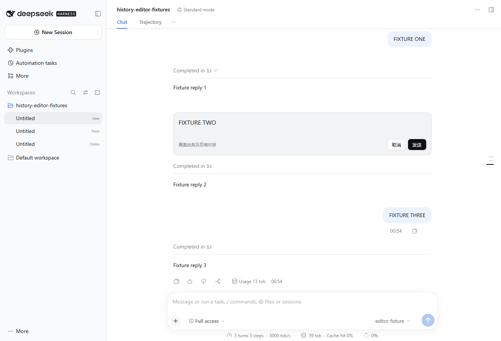

# 历史消息编辑 1.3.1

在原会话里编辑历史用户消息，并从修改处重新生成；也可以对某一轮直接重试。会话 ID、侧栏条目和工作目录继续沿用。回复还在生成时也能编辑：发送会先中断当前这一轮，再覆盖消息重新发送。

适配 Windows DSH Next **2.0.24-next**，内置 Harness **0.2.2-rc.5**。



鼠标移到已发送的消息上，复制按钮旁会多出铅笔和重试两个按钮。

- **编辑**：点击铅笔修改正文，正文没有改动时「发送」保持置灰，改回原文也会重新置灰。修改后点击「发送」，本次操作将覆盖这条消息及之后的聊天记录，继续使用同一个会话、侧栏条目和工作目录。取消编辑可点击「取消」或按 Esc。回复还在生成时同样可以打开编辑器，按钮会变成「中断并重发」：提交时先停止当前这一轮，等它停下来再写入新的正文并重新生成，中途断掉的半截回复一并被覆盖。
- **重试**：点击重试按钮直接重跑这一轮，正文保持原样，用于模型请求失败、回复中途报错或想把这一轮重新生成一次的情况。重试与编辑共用覆盖逻辑，同样会覆盖这条消息之后的记录；回复生成中点击重试会先中断当前这一轮。

排队中的输入不会被静默丢弃，也不会把你卡死：

- 会话里还有**真正排队的用户消息**时，第一次点击只会提示「还有 N 条排队中的输入」，按钮随即变成「丢弃并重发」，再点一次才连同队列一起丢弃并重发（重试按钮则是 60 秒内再点一次确认）。
- 停止或中断后残留的 steering / 已注入上下文不算用户消息，会在中断时一并清掉——这正是以前「已停止却一直提示还有排队输入、编辑和重试全都失败」的原因。

已执行过的工具操作仍可能影响工作区。

## 安装与升级

在 DSH 插件管理器选择添加插件，输入 `dsh-history-message-editor@1.3.1`。也可以用 [GitHub Release 安装包](https://github.com/DreamYuande/dsh-history-message-editor/releases/download/v1.3.1/dsh-history-message-editor-1.3.1.tgz) 的链接安装，或下载后添加本地 `.tgz`。如果管理器提示已安装，可在插件详情里卸载旧版后更新。安装完成后按桌面提示重载。

```powershell
dsh plugin --profile desktop add dsh-history-message-editor@1.3.1
dsh plugin --profile web add dsh-history-message-editor@1.3.1
dsh plugin --profile desktop remove dsh-history-message-editor
```

## 历史与附件

- 原始事件作为底层日志留存。所覆盖的内容退出模型上下文，并在插件启用时退出主聊天视图。停用插件会移除聊天过滤，底层事件仍在，所覆盖的内容仍不进入新请求的模型上下文。
- DSH 已压缩或已经覆盖的历史会拒绝提交；会话里还有排队输入时会提示先处理。回复生成中的提交会中断当前这一轮（等价于按一次停止，排队输入仍保留），等会话安静下来再写入新正文。编辑期间若有其它操作改变会话，请重新打开编辑器。传输中断后请先检查聊天内容。
- 图片和文件复用当时保存下来的附件引用。附件不可用或当前模型不支持图片时，提交会停止。
- 已有 1.0.0 生成的分支可以继续在 DSH 中打开。升级无需迁移会话。

## 开发

宿主注册 DSH Connection 的已认证所有者路由，在 Agent 的维护阶段调用 DSH 的历史替换和原生发送；需要中断时先调用 Agent 的取消接口并等它确认安静，再进入维护阶段。是否要中断由宿主根据 Agent 的实际状态判断，页面的「正在生成」标记只用来改按钮文案——停止或刚结束的那一瞬间两边会短暂不同步。客户端使用消息节点标记挂载编辑和重试按钮，以及聊天过滤。无运行时 npm 依赖。

```powershell
node .\build.mjs
node --test
pnpm pack
```

参考 [DSH Next 版本说明](https://github.com/anywhere-labs/dsh-desktop/releases/tag/v2.0.24-next)、[Harness Session](https://github.com/deepseek-ai/deepseek-harness/blob/dsh-v0.2.2-rc.5/docs/subsystems/session.md) 和 [dsh-rewind 的原会话回退思路](https://github.com/SiriLee/dsh-rewind)。

## English

Edit a previous user message and regenerate its reply in the same DSH session, or retry a round as it is. The editor reuses stored image and file references. Sending an edit replaces that message and later entries in the active model context and main chat view; the retry button sends the unchanged body through the same path, which is the quickest way to redo a round whose model request failed. While a reply is still streaming the button reads "interrupt and resend": the running round is stopped first, then the edited body is written and regenerated. The underlying event log keeps the original records. The workspace directory and existing tool side effects are retained.

Tested with DSH Next 2.0.24-next on Windows (Harness 0.2.2-rc.5). Install `dsh-history-message-editor@1.3.1` in the DSH plugin manager or use the prebuilt tarball from [GitHub Releases](https://github.com/DreamYuande/dsh-history-message-editor/releases/tag/v1.3.1).
